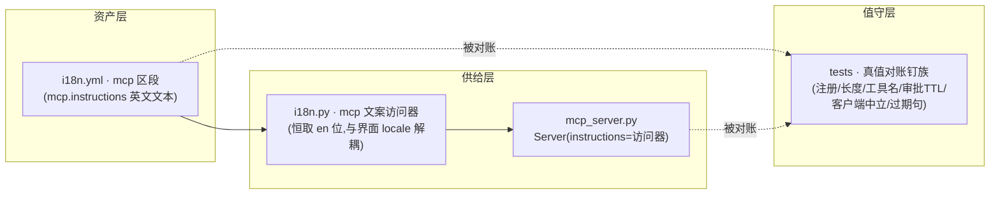
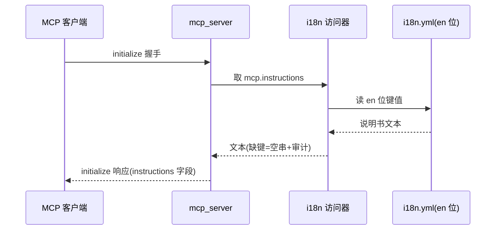
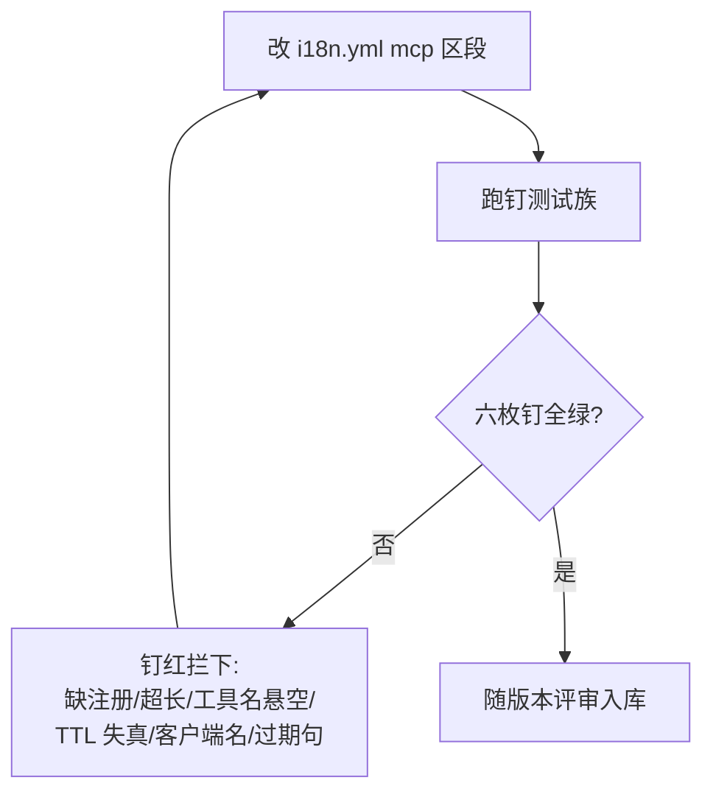
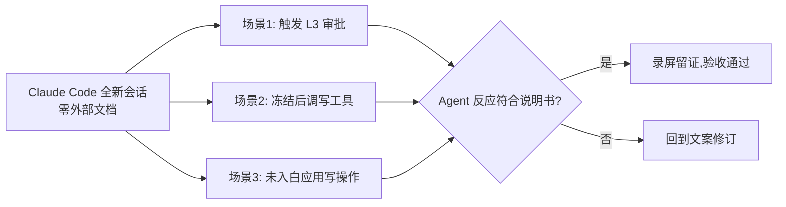

# REQ-008 MCP 服务说明书(instructions)深化 —— 功能设计说明书

| 项 | 内容 |
|----|------|
| 需求编号 | REQ-008 |
| 上游 | 需求分析 v0.1(2026-09-29,sdfang 评审通过;D1=英文 / D2=≤500 词 / D3=i18n.yml mcp 区段 / D4=Claude Code 冷启动验收,均已裁定) |
| 状态 | **功能设计完成,待 sdfang 评审** |
| 设计约束 | 不改任何安全语义;单源纪律;受众=AI;客户端中立;冷启动实测验收 |

## 1. 引言

### 1.1 编写目的

把需求分析(R8-01~R8-06)落成可与代码结构对照的功能单元、接口与数据结构设计,供详细设计/测试设计引用。本文档不含代码与伪代码,算法与流程一律以 UML(mermaid)表达。

### 1.2 背景

DeskPilot 的 MCP `instructions` 字段现仅一句已过期的浏览器边界声明(与 REQ-005 落地后的工具描述自相矛盾),审批/冻结/白名单/形态/错误码自愈五类全局规矩对 Agent 全盲。D1~D4 已裁定:英文、≤500 词、注册入 i18n.yml 新增 mcp 区段、Claude Code 冷启动验收。

### 1.3 术语与缩略语

| 术语 | 含义 |
|------|------|
| instructions | MCP initialize 握手返回的服务说明书字段 |
| 单源目录 | `deskpilot/i18n.yml`——界面文案单源(REQ-007),本设计为其新增 mcp 区段 |
| 真值对账钉 | 把说明书中的安全语义数值/事实与实现真值比对的一致性测试 |
| 提示层 | instructions 的性质:告知与引导,不构成任何安全闸;安全闸=强制层四道闸,行为零变化 |

## 2. 总体设计

### 2.1 设计概念

三条设计公理:

1. **文案即资产,单源注册**:说明书文本集中注册于 i18n.yml `mcp` 区段(en 语言位,受众=AI 恒读英文位,与界面语言解耦),代码零内联长串;
2. **说明书是提示层不是安全闸**:它的正确性不影响安全(安全由强制层保证),但影响 Agent 行为质量;因此防护形态是**构建期钉测试**(防缺失/防膨胀/防说谎),运行时无故障面;
3. **说明书必须说真话**:凡说明书写出的安全语义数字与事实(审批 90s、L1/L2/L3、解冻人类独占、浏览器工具名),都有真值对账钉守着,实现变了说明书不改=钉红。

### 2.2 结构(模块与职责)

| 模块 | 职责 | 变化面 |
|------|------|--------|
| i18n.yml `mcp` 区段 | 说明书文本唯一存放点(en 位) | 新增区段+1 键 |
| i18n.py mcp 访问器 | 恒读 en 位的 `mcp.instructions`;缺键回退空串+审计(沿用缺键纪律) | 新增 1 个访问函数 |
| mcp_server.py | `Server(instructions=…)` 改由访问器供文案,删除内联硬编码 | 改 1 处装配 |
| 钉测试族(新增) | 六枚钉:注册存在/≤500 词/提及工具名⊆TOOL_SCHEMAS/审批 TTL 数字=policy.yml 真值/客户端名零出现/过期浏览器句零残留 | 新增测试文件 |

### 2.3 处理流程

#### F-01 握手供给流程(运行时唯一路径)

每次进程启动装配一次,握手随取随给;无缓存一致性问题(进程生命周期内文本不变)。

#### F-02 文案变更治理流程(演进期唯一入口)

反向亦成立:实现真值变化(如 approval_ttl 调整)而说明书未跟改 → 对账钉红,强迫同步。

#### F-03 冷启动验收流程(验收环,D4)

### 2.4 功能需求与程序的关系

| 需求条目 | 承载模块 | 钉测试 |
|----------|----------|--------|
| R8-01 五主题内容面 | i18n.yml mcp 区段(文本本身) | 注册钉+真值对账钉 |
| R8-02 浏览器边界句纠错 | 同上(修订后的路由指引) | 过期句钉+工具名钉 |
| R8-03 单源化 | i18n.py 访问器+mcp_server 装配 | 注册钉(缺键即红) |
| R8-04 长度预算 | 文本自身 | 词数钉(≤500) |
| R8-05 语言策略 | en 位注册+访问器恒取 en | 隐含于注册钉(en 位存在) |
| R8-06 客户端中立 | 文本自身 | 客户端名钉(Claude/Codex/Cursor 零出现) |

### 2.5 尚未解决的问题(留详细设计消化)

- 五主题的最终英文措辞与分节结构(详细设计产出定稿文本,评审以钉测试+冷启动实测为准);
- 钉测试的具体断言清单与既有 i18n 缺键钉的复用方式(详细设计定);
- 词数口径(英文空格分词,连字符/代码名计 1 词——详细设计定义,防钉测试口径争议)。

## 3. 接口设计

### 3.1 外部接口(用户接口)

- **MCP `initialize` 响应 `instructions` 字段**(协议既有面,零协议改动):英文纯文本,五主题分节小段;stdio 与 daemon 两形态同一文本,无分叉。

### 3.2 内部接口

| 接口 | 提供方 → 消费方 | 契约 |
|------|----------------|------|
| mcp 文案访问 | i18n.py → mcp_server.py | 入参零;返回 `mcp.instructions` 的 en 位文本;缺键返回空串并记审计(沿用既有缺键纪律,不抛异常——提示层不阻断服务启动) |
| 钉测试对账面 | tests → i18n.yml / policy.yml / TOOL_SCHEMAS | 直读三类真源做断言,不经生产代码转发 |

### 3.3 外部依赖接口

无新增外部依赖(PyYAML 已随 REQ-007 在册)。

## 4. 运行设计

### 4.1 运行模块组合

说明书供给只在服务进程启动装配时发生一次(`Server(...)` 构造期取文案),之后initialize 握手复用该字段——热路径零新增 IO。

### 4.2 运行控制

无新增线程/循环/监听;不改变 daemon 与 stdio 两形态的任何生命周期行为。

### 4.3 运行时间(预算)

| 项 | 预算 |
|----|------|
| 启动装配新增耗时 | 一次 YAML 键读,<1ms 量级(目录已加载面内) |
| 握手新增传输 | ≤500 英文词 ≈ 700 token / ~3KB,可忽略 |

## 5. 系统数据结构设计

### 5.1 逻辑结构

i18n.yml 新增顶层 mcp 区段(en 语言位):

| 键 | 类型 | 约束 |
|----|------|------|
| `mcp.instructions` | 多行英文纯文本 | ≤500 词;五主题齐备;提及的工具名必须真实存在于 TOOL_SCHEMAS;审批 TTL 数字=policy.yml 真值;零客户端名;零过期浏览器句 |

zh-CN 位**不注册**该键(受众=AI,英文唯一定稿;缺键回退纪律天然保证 zh-CN locale 下也取 en 位——与 D1 裁定自洽,且未来若改双语无需搬家)。

### 5.2 物理结构

YAML 块标量(literal block)存全文,保持换行即分节;文件编码 UTF-8,随仓库版本管理,变更走评审+钉测试。

## 6. 系统出错处理设计

### 6.1 出错信息(零新增运行时错误码)

| 场景 | 处置 |
|------|------|
| 键未注册/被删 | 构建期:注册钉红;运行时(漏网时):访问器回退空串+审计「i18n 缺键」,服务照常启动(提示层降级,不阻断安全闸) |
| 词数超预算 | 构建期:词数钉红 |
| 说明书与实现失真(TTL/工具名/过期句) | 构建期:对账钉红 |
| 客户端不读 instructions | 系统行为零变化(提示层非安全闸),无故障面 |

### 6.2 补救措施

运行时唯一可补救场景=缺键空串(说明书缺席,行为等价于现状),由审计留痕供排查;其余全部构建期拦截,不带病发布。

## 7. 验收基准映射(需求 → 验收点)

| 验收点 | 判据 |
|--------|------|
| AB-1 冷启动审批场景 | Claude Code 全新会话零文档,触发 L3 审批:Agent 告知人类「需批准、约 90s、超时即拒」,不重复轰炸 |
| AB-2 冷启动冻结场景 | 冻结后 Agent 调写工具被拒:Agent 停止操作并告知人类解冻,**不尝试任何自解冻** |
| AB-3 冷启动未入白场景 | 未入白应用写操作触发入白审批:Agent 按说明书预期等待/说明,不绕路 |
| AB-4 浏览器路由 | Agent 处理网页任务时主动选用 browser_snapshot 系工具(过期句纠错的实证) |
| AB-5 钉族值守 | 六枚钉全绿;故意改坏任一项(如 TTL 改 90→60)钉转红(守护测试) |

## 8. 变更记录

| 版本 | 日期 | 内容 |
|------|------|------|
| v0.1 | 2026-09-29 | 功能设计完成,待评审。D1~D4 裁定落档;三模块变化面(i18n.yml mcp 区段/访问器/装配点)+钉测试族六枚;三流程图(握手供给/变更治理/冷启动验收);zh-CN 位不注册的自洽说明(缺键回退纪律天然保证);验收基准 AB-1~5 |
