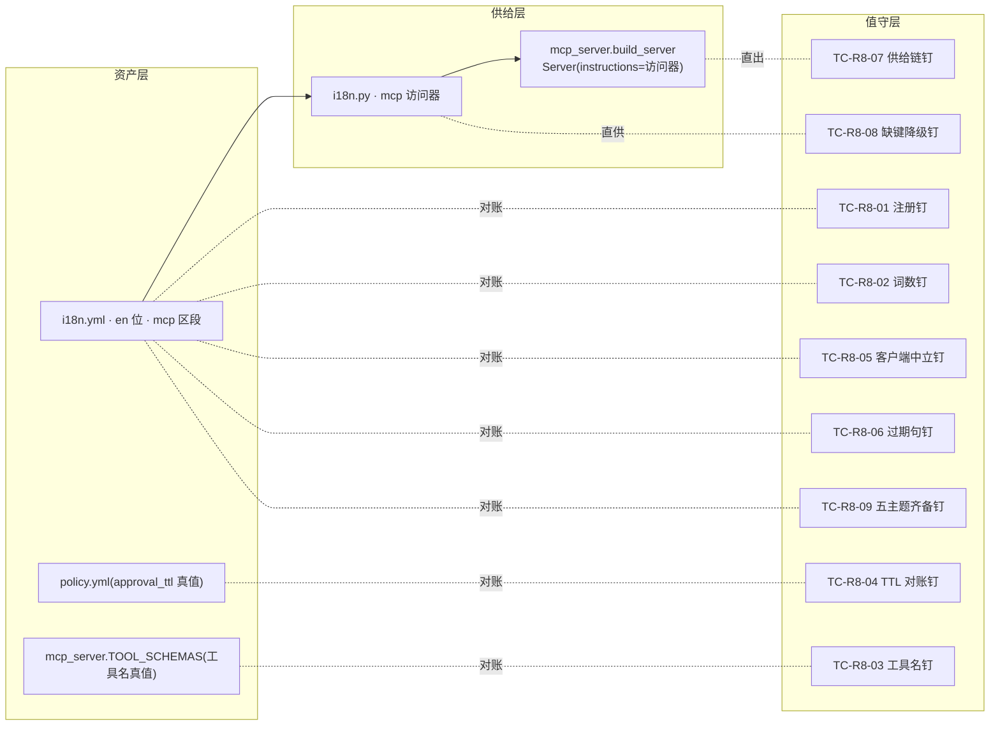
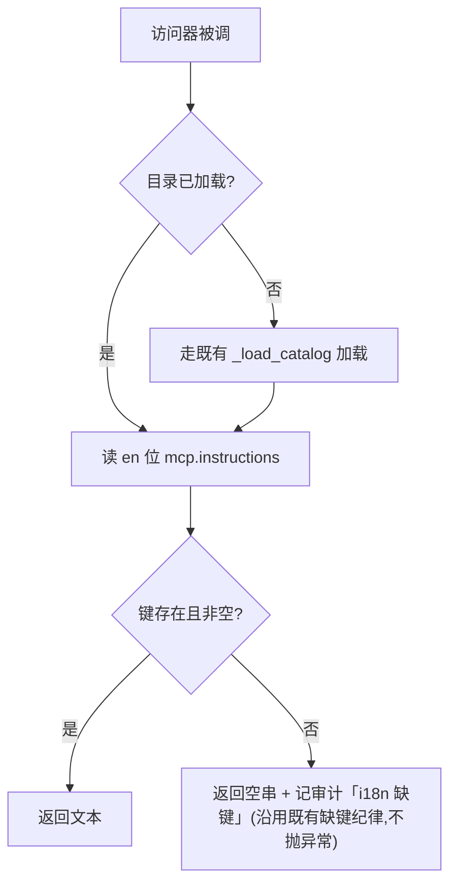

# REQ-008 MCP 服务说明书(instructions)深化 —— 详细设计说明书

| 项 | 内容 |
|----|------|
| 需求编号 | REQ-008 |
| 上游 | 需求分析 v0.1 + 功能设计 v0.1(均经 sdfang 评审通过;D1=英文/D2=≤500 词/D3=i18n.yml mcp 区段/D4=Claude Code 验收) |
| 状态 | **详细设计完成,待 sdfang 评审** |
| 设计约束 | 不改安全语义;零新增运行时错误码;文档不含代码与伪代码(流程用 mermaid) |

## 1. 引言

### 1.1 编写目的

给出 REQ-008 的可实现设计:数据结构与文本定稿、模块内部处理逻辑、钉测试断言清单、既有钉的适配登记,使 SDD 先红后绿可直接照此施工。

### 1.2 范围

在功能设计圈定的三处变化面(i18n.yml mcp 区段 / i18n.py 访问器 / mcp_server.py 装配点)上加一组钉测试;其余一律不动。既有测试适配一处:TC-BOUND-01(断言语种随说明书英化而改,见 §3.4 闸门登记)。

### 1.3 术语

| 术语 | 含义 |
|------|------|
| 访问器 | i18n.py 新增的 mcp 文案读取函数,恒取 en 位 |
| 词数口径 | 按 ASCII 空白分词;连字符词、代码名(如 `browser_snapshot`)各计 1 词;标点不计 |
| 真值对账 | 说明书文本中的事实性声明与实现真源(policy.yml / TOOL_SCHEMAS / errors.py)比对 |

## 2. 程序系统结构

## 3. 模块设计说明

### 3.1 数据结构设计:说明书文本定稿(i18n.yml en 位 `mcp.instructions`)

英文定稿全文(约 230 词,预算 ≤500 留足演进余量;分节即 YAML 块标量换行):

> **DeskPilot — safe, human-supervised operation of the Windows desktop.**
>
> Scope and routing:
> - Use this service for the Windows desktop and native application windows (screenshots, UI element trees, mouse, keyboard).
> - For content inside web pages, first read or locate with browser_snapshot / browser_get_rect, then act with the same mouse and keyboard tools at the returned coordinates.
>
> Approvals (human-in-the-loop):
> - High-risk operations and the first write to a new application trigger a human approval dialog. Approval waits about 90 seconds; without a human answer the call fails with APPROVAL_TIMEOUT. Never retry in a loop — report to the human and wait.
> - To observe an approval outcome, your tool-call timeout must exceed 95 seconds.
>
> Emergency stop (freeze):
> - The human can freeze this service at any time. While frozen, every write operation is refused with EMERGENCY_STOP.
> - Only the human can unfreeze (freeze-card button or hotkey). You have no unfreeze channel — never attempt one; stop operating and tell the human.
>
> Whitelist and levels:
> - Each target process is whitelisted at a level: L1 read-only, L2 normal writes, L3 high-risk writes gated by approval.
> - The whitelist and policy files are human-owned; never attempt to modify them.
>
> Forms and errors:
> - The service runs as a persistent daemon or a stdio session; desktop state (window bindings, freeze) persists across calls either way.
> - Errors are self-service: follow the error code's guidance (WINDOW_GONE → re-locate the window; TYPE_MISMATCH → re-check focus; READBACK_UNAVAILABLE → switch strategy). Ask the human only after self-recovery fails.

文本内部锚点(供钉测试):五节标题行(Scope and routing / Approvals / Emergency stop / Whitelist and levels / Forms and errors);数字锚点 `90`/`95`;工具名锚点 `browser_snapshot`、`browser_get_rect`;错误码锚点 APPROVAL_TIMEOUT/EMERGENCY_STOP/WINDOW_GONE/TYPE_MISMATCH/READBACK_UNAVAILABLE。

### 3.2 M1:i18n.py mcp 访问器

职责:恒取 en 位 `mcp.instructions`,与界面 locale 解耦(受众=AI,D1)。

接口契约:入参零;返回字符串。复用 `_load_catalog`/`_audit_missing` 既有缝,零新增 IO 路径。

### 3.3 M2:mcp_server.py 装配点

`build_server` 内 `Server("deskpilot", instructions=...)` 的内联硬编码删除,改为调用 M1 访问器。装配时机=进程启动一次;握手复用该字段,热路径零新增开销。

### 3.4 既有测试适配(双闸门登记)

| 钉 | 适配内容 | 理由 |
|----|----------|------|
| TC-BOUND-01(test_boundary_iss15.py) | 断言由中文锚点(「Windows 桌面」「浏览器」)改为英文锚点(「Windows desktop」「browser_snapshot」) | D1 裁定说明书英化,原中文断言必然失效;钉的原意(说明书含服务级路由规则)不变 |

### 3.5 钉测试族断言清单(tests/test_mcp_instructions_req008.py)

| 用例 | 断言(全部直读真源,不经生产转发) |
|------|----------------------------------|
| TC-R8-01 注册钉 | i18n.yml en 位存在 `mcp.instructions` 且非空 |
| TC-R8-02 词数钉 | 词数口径下 ≤500 词 |
| TC-R8-03 工具名钉 | 文本中全部 `snake_case` 形态工具名 ⊆ TOOL_SCHEMAS 键集 |
| TC-R8-04 TTL 对账钉 | 文本中的审批秒数 == policy.yml `timeouts.approval_ttl` 真值(现为 90);含 >TTL+5 的预算指引(95) |
| TC-R8-05 客户端中立钉 | Claude/Codex/Cursor/GPT 等客户端名零出现(大小写不敏感) |
| TC-R8-06 过期句钉 | 旧中文句「勿用本服务」零残留;文本必含 browser_snapshot(新路由指引在场) |
| TC-R8-07 供给链钉 | `build_server(ctx).instructions` == 访问器输出(装配真实接通) |
| TC-R8-08 缺键降级钉 | 替身目录缺键时访问器返回空串并触发缺键审计,不抛异常 |
| TC-R8-09 五主题钉 | 五节标题锚点全部在场 |

守护测试(AB-5)并入 TC-R8-04 用例说明:把 policy.yml 替身副本 TTL 改 60 断言行必须转红(变异验证,防钉成摆设)。

## 4. 接口设计汇总(实现期契约)

| 接口 | 方向 | 契约 |
|------|------|------|
| mcp 访问器 | i18n.py → mcp_server.py | 零入参 → str;缺键=空串+审计 |
| initialize instructions | mcp_server → MCP 客户端 | 协议既有字段,英文纯文本,两形态同文 |
| 钉测试对账面 | tests → i18n.yml / policy.yml / TOOL_SCHEMAS / build_server | 直读断言 |

## 5. 限制条件

- 说明书只在进程启动装配一次;运行期改 i18n.yml 对已起进程不生效(与界面文案 reload 面无关,不引入热加载);
- zh-CN 位不注册该键(D1);缺键回退纪律保证任何 locale 下访问器都取到 en 位;
- 词数口径以 §1.3 定义为准,钉测试与文本同口径,防口径争议。

## 6. 出错处理(零新增错误码)

| 场景 | 处置 |
|------|------|
| 键缺失/空 | 运行时:空串+审计(提示层降级不阻断启动);构建期:TC-R8-01 红 |
| 超长/失真/过期 | 构建期钉红,不带病发布 |
| 客户端忽略 instructions | 系统行为零变化(提示层非安全闸) |

## 7. 测试计划要点(测试设计的输入)

- 单元层:TC-R8-01~09(直读资产/装配,零桌面依赖,CI 可跑);
- 守护层:TC-R8-04 附变异验证(替身 TTL 改值必须转红);
- 验收层(人工,D4):Claude Code 冷启动三场景(AB-1 审批/AB-2 冻结/AB-3 未入白)+AB-4 浏览器路由实证,录屏留证;
- 适配登记:TC-BOUND-01(§3.4)。

## 8. 变更记录

| 版本 | 日期 | 内容 |
|------|------|------|
| v0.1 | 2026-09-29 | 详设完成,待评审。说明书英文定稿全文(~230 词,五主题+浏览器新路由);M1 访问器/M2 装配点设计;钉族九枚断言清单;TC-BOUND-01 适配登记;词数口径定义;零新增错误码 |
| v0.2 | 2026-09-29 | **P1 实现完成**:i18n.yml en 位 `mcp.instructions` 注册(实测 251 词);i18n.py `mcp_instructions()` 访问器;build_server 装配改访问器供文案。红→绿:TC-R8-01~09 全绿;TC-BOUND-01 适配落地;i01 双语完备钉增 `mcp.*` 豁免(第二处适配登记,D1 自洽)。全量回归 999 绿。冻结形态 stdio initialize 实证(1627 字符/251 词) |
